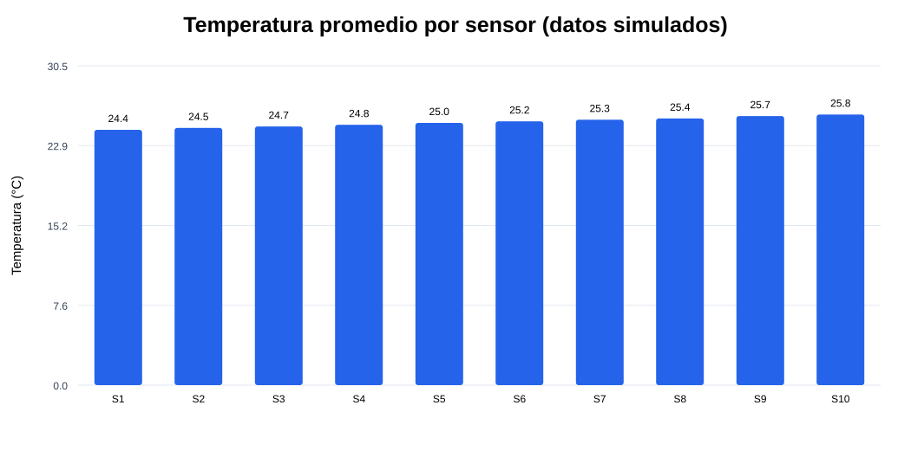
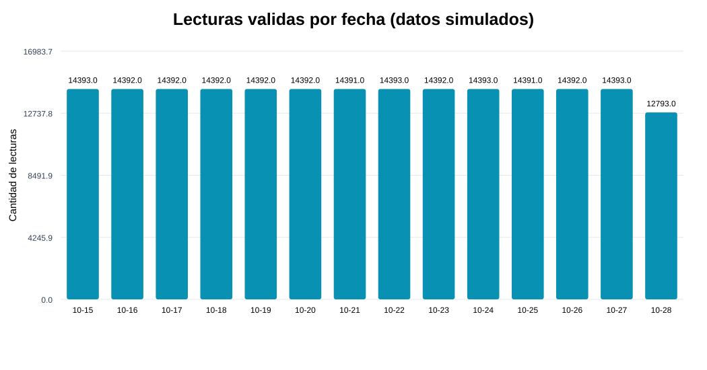

# Tarea 3 – Big Data UNAD: Apache Spark y Kafka

Proyecto académico de **procesamiento batch con Apache Spark (PySpark)** y demostración complementaria de **procesamiento en tiempo real con Apache Kafka y Spark Structured Streaming**.

**Curso:** Big Data (202016911) · Universidad Nacional Abierta y a Distancia (UNAD).

**Video explicativo:** [Ver demostración en YouTube](https://youtu.be/5zo7vCoyvH4).

> **Importante:** todos los datos de sensores de este proyecto son **sintéticos/simulados** y se usan únicamente con fines académicos. No son mediciones de dispositivos físicos ni provienen de una fuente pública externa.

## 1. Problema y objetivo

Se simula un sistema de monitoreo ambiental con diez sensores. El objetivo es detectar registros incompletos, duplicados o fuera de rango, calcular estadísticas de temperatura y humedad por sensor y analizar la cantidad de lecturas por fecha. Complementariamente se simula el flujo de eventos nuevos en Kafka y su procesamiento continuo en Spark.

## 2. Contenido del repositorio

| Archivo o carpeta | Función |
| --- | --- |
| `datos_sensores_200000.csv` | Datos históricos sintéticos para el procesamiento batch (200.000 registros base, más 19 duplicados intencionales). |
| `generar_datos.py` | Generador determinista del CSV (semilla 20261029). |
| `batch_spark.py` | Procesamiento batch: lectura, validación, limpieza, EDA y exportación de resultados. |
| `kafka_producer.py` | Envío de eventos sintéticos al topic Kafka `sensor_data`. |
| `spark_streaming_consumer.py` | Lectura de Kafka y medias por sensor y ventana de un minuto. |
| `resultados_batch/` | CSV, resumen del control de calidad y gráficas SVG del análisis del dataset incluido. |
| `requirements.txt` | Bibliotecas Python opcionales si se prepara un entorno local desde cero. |

## 3. Entorno utilizado

- Ubuntu 22.04, Apache Spark **3.5.8**, Python **3.10**, Java **11**.
- Para streaming: Apache Kafka **3.9.2**, ZooKeeper y `kafka-python`.
- La práctica se ejecutó en una máquina virtual con Spark instalado y accesible con `spark-submit`.

## 4. Ejecución del procesamiento batch

Desde una terminal de Ubuntu con Spark previamente instalado:

```bash
cd /ruta/a/la/carpeta/del/proyecto
spark-submit batch_spark.py
```

El programa lee automáticamente `datos_sensores_200000.csv` desde su misma carpeta. **No requiere Kafka ni Internet** si Spark ya está instalado. También se pueden regenerar los datos:

```bash
python3 generar_datos.py
```

**Reglas de limpieza:** eliminar filas duplicadas; conservar identificadores de sensor entre 1 y 10 y fechas válidas; requerir temperatura entre 0 y 40 °C y humedad entre 0 y 100 %; descartar filas incompletas. Se calcula EDA con `groupBy`, `count`, `avg`, `min`, `max` y ordenamientos.

### Resultados del conjunto de datos simulado

- Registros originales (incluyendo duplicados): **200.019**.
- Filas duplicadas: **19**.
- Registros con temperatura ausente o inválida: **66**.
- Registros con humedad ausente o inválida: **49**.
- Registros válidos para el análisis: **199.891**.

Los conteos de anomalías de temperatura y humedad pueden solaparse, por lo cual no deben sumarse directamente para calcular los registros descartados.

Las salidas se crean en `resultados_batch/`: `resumen_ejecucion.txt`, `resumen_por_sensor.csv`, `resumen_por_fecha.csv`, `temperatura_por_sensor.svg` y `lecturas_por_fecha.svg`. Las gráficas SVG se abren directamente en un navegador.





## 5. Procesamiento de datos en tiempo real

Esta parte es **independiente del procesamiento batch** y requiere un broker Kafka funcional en `localhost:9092`, con el topic `sensor_data` creado. Por ejemplo, con Kafka instalado en `/opt/Kafka` y ZooKeeper habilitado según el instructivo de la actividad:

```bash
/opt/Kafka/bin/kafka-topics.sh --create --if-not-exists --bootstrap-server localhost:9092 --replication-factor 1 --partitions 1 --topic sensor_data
```

En una terminal (productor):

```bash
python3 -m pip install --user kafka-python
python3 kafka_producer.py
```

En **otra** terminal (consumidor con Spark 3.5.8):

```bash
spark-submit --packages org.apache.spark:spark-sql-kafka-0-10_2.12:3.5.8 spark_streaming_consumer.py
```

**Qué hace:** el productor simula temperatura, humedad, identificador de sensor y timestamp Unix cada segundo; el consumidor convierte JSON a DataFrame, transforma el timestamp y calcula medias por sensor en ventanas de un minuto, mostrando actualizaciones en consola. Se requiere Internet la primera vez que se descargan las dependencias de Maven; posteriormente suelen reutilizarse desde caché.

Con la aplicación de Spark activa, su interfaz web suele estar disponible en `http://IP_DE_LA_VM:4040` (o `4041` si el puerto está ocupado). Las pestañas **Jobs, Stages, Environment, Executors y Structured Streaming** permiten consultar la actividad mientras el proceso sigue ejecutándose.

Para detener los programas, usa `Ctrl+C` en cada terminal.

## 6. Alcance y limitaciones

- Datos de prueba creados con un generador; resultados no describen sensores reales.
- Los agregados batch corresponden a un archivo CSV estático. Streaming genera nuevos eventos de manera separada; **no son los mismos registros**.
- El procesamiento se realizó en modo local de Spark, no en un clúster de múltiples nodos.
- Los resultados dentro de `resultados_batch/` pueden regenerarse ejecutando `batch_spark.py` sobre el mismo CSV.

## 7. Evidencia en video

[Demostración de la Tarea 3 en YouTube](https://youtu.be/5zo7vCoyvH4)

---
**Uso académico.** Proyecto desarrollado para la Tarea 3 del curso Big Data de la UNAD.
